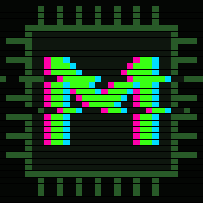
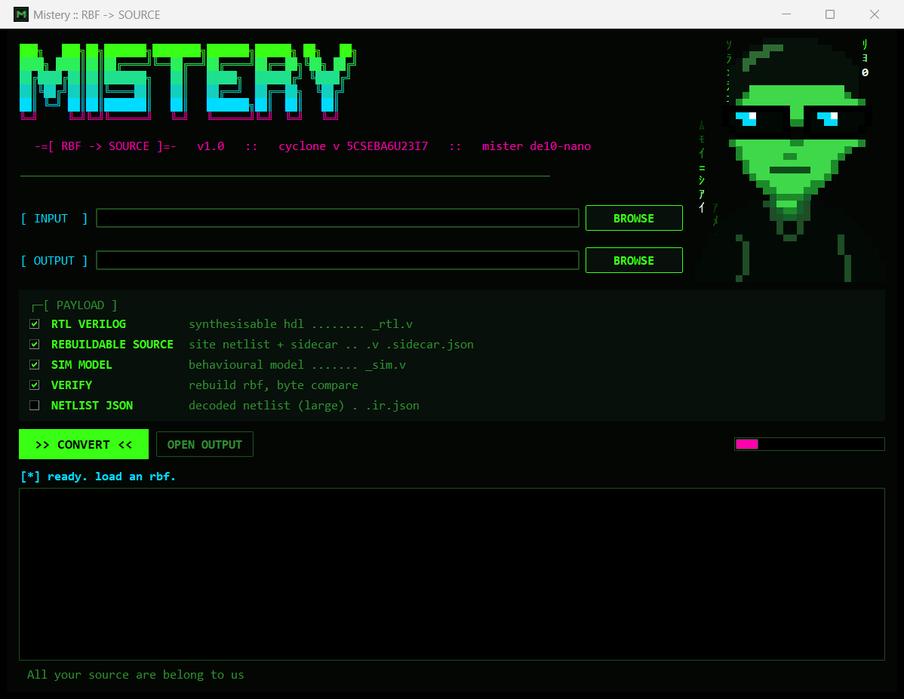

<p align="center">
  
</p>

```
███╗   ███╗██╗███████╗████████╗███████╗██████╗ ██╗   ██╗
████╗ ████║██║██╔════╝╚══██╔══╝██╔════╝██╔══██╗╚██╗ ██╔╝
██╔████╔██║██║███████╗   ██║   █████╗  ██████╔╝ ╚████╔╝
██║╚██╔╝██║██║╚════██║   ██║   ██╔══╝  ██╔══██╗  ╚██╔╝
██║ ╚═╝ ██║██║███████║   ██║   ███████╗██║  ██║   ██║
╚═╝     ╚═╝╚═╝╚══════╝   ╚═╝   ╚══════╝╚═╝  ╚═╝   ╚═╝
          -=[ RBF -> SOURCE ]=-   MiSTer FPGA bitstream decompiler
```

<p align="center">
  
  
  
  
</p>

**Mistery takes a MiSTer FPGA core (`.rbf`) and turns it back into source code.** Load the bitstream, pick
an output folder, hit convert. Out comes source you can read, simulate, edit and **rebuild into a new RBF**.
Change the logic, patch a ROM table, tweak a RAM's contents, then drop the rebuilt core on your MiSTer.

<p align="center"></p>

---

## `> what you get`

| Output | What it is |
| --- | --- |
| `NAME.v` + `NAME.sidecar.json` | **Rebuildable source.** Every configured logic block, RAM, DSP and I/O of the bitstream as Verilog, with its configuration as plain-text parameters; routing in the sidecar. Rebuilt unchanged it gives back the original RBF **byte for byte**; rebuilt with your edits it gives your modified core. |
| `NAME_rtl.v` | **RTL Verilog.** Self-contained, synthesisable HDL: every LUT as a boolean equation, every flip-flop as an `always` block, RAMs as arrays with their contents, multipliers as `*`. Flattened logic, named after the hardware. |
| `NAME_sim.v` + `rbf_prims.v` | **Simulation model** of the core for Icarus / Verilator / ModelSim. |
| `NAME.rebuilt.rbf` | The RBF rebuilt from the source, compared byte for byte with the original (Verify). |
| `NAME.ir.json` | The full decoded netlist as JSON, for your own tools. |

Under the hood: a lossless bitstream decoder (Cyclone V configuration RAM, LAB/MLAB logic, M10K, DSP,
routing), a decoded model of the ALM/LUT/flip-flop/RAM semantics checked against Quartus, and a compiler
that writes the bitstream back.

---

## `> download`

Grab **Mistery v1.0** from the [Releases](../../releases) page, unzip anywhere.

1. Run `Mistery.exe`. That's it.

Windows 10/11 x64. 89 MB, fully self-contained: no installer, no Python, no Quartus.

---

## `> rip it, edit it, rebuild it`

```
 [1] CONVERT   Mistery.exe -> INPUT: core.rbf -> OUTPUT: folder -> >> CONVERT <<
 [2] EDIT      open core.v, change what you want (keep core.sidecar.json next to it)
 [3] REBUILD   REBUILD RBF -> pick core.v -> save core_mod.rbf
 [4] LOAD      copy core_mod.rbf to the MiSTer SD card and launch it
```

**1. Convert.** Pick the RBF and an output folder, leave the payload ticks on, press **CONVERT**.
Command line: `mistery-convert.exe core.rbf out\`

**2. Edit.** `core.v` has one instance per used block on the chip, named by position
(`LAB_038_012`, `M10K_049_001`, ...). Its parameters are the configuration:

- `LUT_MASK__n` &nbsp; the truth table of ALM *n* (64 bits) — change the logic function
- `RAM__n` &nbsp; row *n* of an M10K / MLAB — change ROM and RAM contents
- mode, clock, enable and inversion parameters of every block

Use `core_rtl.v` and `core_sim.v` to understand what a block does before you touch it, and simulate your
change first.

**3. Rebuild.** Press **REBUILD RBF**, pick the edited `core.v`, choose where to save the new RBF.
Command line: `mistery-convert.exe --rebuild out\core.v core_mod.rbf`

Untouched source rebuilds the identical RBF — run it once without edits and compare to prove your setup.

**4. Load.** Copy the RBF to the SD card (for arcade cores into `_Arcade/cores/`, named the way the MRA
expects, e.g. `Arcade-MyCore.rbf`) and start it from the MiSTer menu.

**Going through Quartus instead:** make a Quartus 17 project for device `5CSEBA6U23I7`, add `core_rtl.v`
as the top level (`rbf_top`), map the `pad_<PIN>` ports to their pins, swap the `RBF_*` black-box modules at
the end of the file for the matching Intel IP (PLL, HPS interface), compile, then
`quartus_cpf -c -o bitstream_compression=on output_files/core.sof core.rbf`.

---

## `> build from source`

```bash
# 1. the bitstream engine (MSYS2 UCRT64 shell)
cmake -G Ninja -S . -B build-win -DCMAKE_BUILD_TYPE=Release
ninja -C build-win

# 2. run the app from source (Python 3 with tkinter)
python rbf2src/gui.py
python rbf2src/convert.py core.rbf out/

# 3. package the Windows exe + release folder (needs PyInstaller)
python rbf2src/packaging/build_exe.py
```


---

## `> repo map`

```
libmistral/   mistral-cv/   Cyclone V bitstream library + CLI (decode / encode / routing database)
generator/    tools/  data/ build-time generators and the MiSTer device database
rbf2src/netlist/            RBF -> netlist IR, rebuildable source, RTL and simulation emitters
rbf2src/sim/                behavioural primitives used by the simulation model
rbf2src/gui.py convert.py   the Mistery app (GUI + command line)
rbf2src/packaging/          exe build, icon, release packaging
```

---

## `> credits`

Built on **[Mistral](https://github.com/Ravenslofty/mistral)**, the open Cyclone V bitstream library by
Olivier Galibert and contributors (BSD 3-Clause, see [`LICENSE`](LICENSE)).
Use Mistery on your own designs and on open-source cores.

<p align="center"><code>All your source are belong to us</code><br><sub>Created by Meathax</sub></p>
